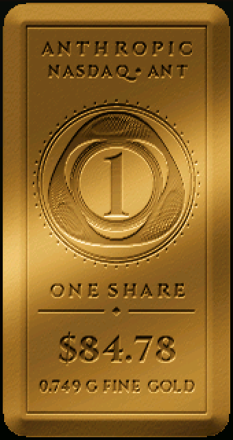
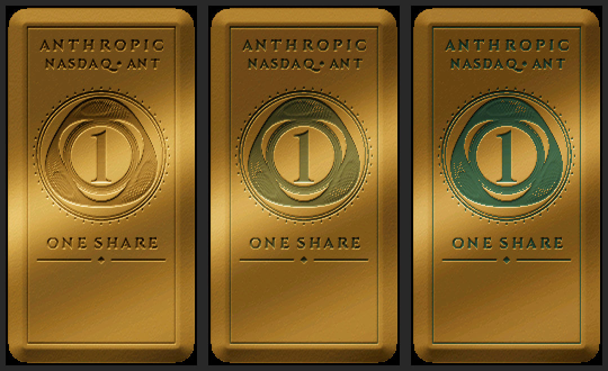

# A Share of Anthropic — 数字金条

一块会呼吸的纪念金条，纪念一股 Anthropic（NASDAQ: ANT）。运行在 **Waveshare ESP32-C6-Touch-LCD-1.9** 上。

金条的正面刻着这一股，并在每天收盘时“称重”一次，换算成当下值多少克真金。背面是一块黑珐琅，记录着它每天说的一句话，以及它在市场里的样子。

引脚和屏幕初始化参数取自 Waveshare 官方示例 `08_FactoryProgram`，其余的渲染、动画、联网都是专门写的。



---

## 烧录

在你自己的电脑上（需要 `pip install esptool`），固件在 [Releases](https://github.com/yuanwil1y/ant-ingot/releases)：

```bash
# 升级，保留已铸造的金条：只写应用分区
esptool.py --chip esp32c6 -b 460800 write_flash 0x10000 ant_ingot.bin

# 全新安装，或者想“重铸”（清空铸造记录、配置、手感参数）
esptool.py --chip esp32c6 erase_flash
esptool.py --chip esp32c6 -b 460800 write_flash 0x0 ant-ingot-merged.bin
```

> ⚠️ **升级时不要用合并镜像。** 它从 0x0 开始连续写入，会覆盖存放铸造记录的 NVS 区域。

升级后第一次开机如果黑屏几秒，是在重新生成金条表面，属于正常现象。

---

## 铸造

1. 开机后屏幕上是一块毛坯锭，挂着一张二维码卡片。手机扫码连上 Wi-Fi `A Share of Anthropic Setup`，配置页会自动弹出；如果没有弹出，就手动打开 `192.168.4.1`。
2. 填写家里的 Wi-Fi、成交价、成交时间（北京时间）、股数和 DeepSeek API Key，然后点 **CHECK & PREPARE**。
3. 卡片上依次打勾：Wi-Fi、行情、DeepSeek。三项都通过后，卡片变成 **READY TO MINT**。
4. **持续摇动**给它加热：摇得越猛，金条越红越亮。烧到白热后开始铸造：冷却，扭索纹从中心浮现，铭文一行行冲压上去，最后一道光扫过。

铸造后，成交价和成交时间会永久保存，作为这根金条的“出身证明”。

---

## 正面：会呼吸的金条

- **刻印区**（铸造时刻上，永不改变）：ANTHROPIC、NASDAQ·ANT、扭索纹和中间的数字 1、ONE SHARE。扭索纹的花样由你的成交价和成交时间生成，每根金条都不一样。
- **动态区**（分隔线以下）：最近一次正式收盘价，以及按当时金价折算的克重，例如 `0.749 G FINE GOLD`。
  - **开盘时（熔炉态）**：数字不跳动，刻槽里像灌着熔岩在缓缓翻涌，周围泛着热晕。高于成本时偏橙黄，更炽热；低于成本时偏暗红。
  - **收盘后（称重仪式）**：实际收盘后约 5 分钟（通常是北京时间早上 5 点多），旧数字熔化抹平，新的收盘价和克重被冲压上去。
  - **铸造当天**：先定格几秒买入价，算作第一次称重。之后如果正在开盘就进入熔炉态，已经收盘就立刻称重。
- **包浆**：持有越久，刻槽里的铜绿越重，高处仍然保持被摩挲出的金色。每天第一次看到它时，会有一道微光扫过。



## 背面：黑珐琅

**摇一摇**翻到背面，**点一下**翻页：

1. **今日一句 + 持有以来**：顶部是罗马数字写的持有天数，下面是 DeepSeek 当天写的一句话，像被刻刀一字一字刻出来。再往下是买入以来的涨跌，以及你买入的日期和时间。
2. **行情 + 自 IPO**：现价、今日涨跌、分时走势（虚线分别是你的成本和昨收，小金锭标记你的买入点）、相对 IPO 价 $83 的倍数、市值，最后一行是开盘/收盘倒计时，或者盘前盘后价。

单日涨跌超过 ±5% 时，右上角会出现一个小菱形。除此之外不会有任何提醒。

---

## 手势

| 动作 | 效果 |
|---|---|
| **来回晃两下** / 短按 BOOT | 正面和背面之间翻转 |
| **点一下**（背面） | 翻页；字正在一个个浮现时，点一下直接显示整句 |
| **长按屏幕** | 尺度彩蛋：从你这一股一直缩放到全部股本，点一下返回 |
| **拿起来** | 放下一段时间后再拿起，会有一道光扫过金面，屏幕也会从暗屏状态亮起 |
| **长按 BOOT 2 秒** | 进入设置模式 |

拿起来看、翻过来看、在手里把玩都不会触发翻面：每一下晃动都必须让总加速度明显偏离 1g，而单纯的转动做不到。一次连续的晃动只翻一次面；翻面过程中如果晃了，会排队，等翻完再补上。默认阈值是 0.9g，觉得不灵敏可以在设置页调低。

**RGB 灯**：开盘时段会极暗地呼吸，高于成本是暖色，低于成本是冷色；铸造和称重时跟着屏幕一起发光；其余时间熄灭。

**蓝牙**：一直广播设备名 `A Share of Anthropic`，旁边的人打开蓝牙列表就能看到。

## 设置模式

长按 BOOT 2 秒，屏幕底部会出现 SETTINGS 提示条。手机连上 `A Share of Anthropic Setup`，或者在同一局域网里打开提示条上显示的 IP，就能进入设置页：

- 修改 Wi-Fi 和 DeepSeek Key
- **手感参数**：晃动阈值、翻面速度和回弹、加热速度、长按时长、亮度等，拖动后实时生效，点 SAVE FEEL 保存
- **晃动仪表**：实时显示最近 3 秒的晃动峰值、当前阈值和识别到的次数，方便调阈值
- **彩排铸造**：重新走一遍加热和铸造的过程，不会改动任何数据
- **预览包浆**：看看持有 N 天后金条的样子（不保存）

15 分钟无操作，或者再次长按 BOOT，会自动退出设置模式。屏幕在 3 分钟无操作后变暗，10 分钟后更暗，拿起或触摸即恢复。

---

## 数据来源

全部免 key，国内可以直连（纳斯达克接口除外，见下）。

| 内容 | 来源 | 刷新频率 |
|---|---|---|
| 报价 | 腾讯 `qt.gtimg.cn` | 开盘时段每 15 秒，盘前盘后每 1 分钟，休市每 10 分钟 |
| 分时、日线 | 腾讯 `web.ifzq.gtimg.cn`（边下载边解析，不占内存） | 开盘时段每 1 分钟；日线每 6 小时，收盘后额外一次 |
| 盘前盘后价 | 新浪 `hq.sinajs.cn` | 盘前盘后每 1 分钟 |
| 金价（伦敦金现货） | 新浪 `hf_XAU` | 每 5 到 10 分钟 |
| 交易日历 | 纳斯达克 `api.nasdaq.com/api/market-info`：当天各时段的准确时间（含半天交易日）、是否交易日、下一个交易日 | 开机时、每 30 分钟、美东换日时 |
| 每日一句 | DeepSeek `deepseek-chat` | 每天一次 |

纳斯达克的接口在美国，如果访问不了，会自动退回“工作日 + 固定时段”推算，节假日和半天交易日的判断会不准，其他功能不受影响。

称重规则：
- 只认时间戳在当天收盘时间之后的报价，盘中价永远不会被刻上去；
- 对时完成之前不称重；
- 当天的称重记录如果和正式收盘价不一致，会自动重称一次。

---

## 技术说明

- **渲染**：金条表面在生成时就按固定顶光一次性算好明暗，然后存进 flash 的独立分区（`surf`），通过内存映射读取，不占 RAM，开机也不用重新生成。每一帧只做查表，屏幕分 8 条通过 DMA 双缓冲推送。动态区在数字变化时单独重新打光。
- **约束**：ESP32-C6 没有浮点单元，所以逐像素的计算全部是整数运算；需要浮点的部分只在生成时、或者每行算一次。
- **晃动识别**：`main/core/motion.c`，只用加速度计。“来回两下”加上“总加速度偏离 1g”这道门槛，用来排除转动。
- **称重**：`main/core/scene.c` 里的 `zone_*` 与 `latest_close`。

## 目录

```
main/core/     可移植的渲染核心（电脑和板子共用）
  scene.c        状态机与所有动画
  ingot.c        金条生成、扭索纹、烘焙光照、调色板
  market.c       交易时段（交易所日历 + 兜底规则）
  motion.c       晃动识别
  gfx.c fonts.c  像素工具与字体
main/*.c       板级代码：屏幕、触摸、IMU、RGB 灯、Wi-Fi/配置页、行情、DeepSeek、蓝牙、存储
host/          电脑上的模拟器
preview/       预览视频和截图
tools/         字体光栅化脚本
fonts-src/     字体源文件（Cinzel、EB Garamond、IBM Plex Mono，均为 OFL 授权）
```

### 编译

```bash
. $IDF_PATH/export.sh          # ESP-IDF v5.5
idf.py set-target esp32c6
idf.py build
```

### 模拟器

不用板子，在电脑上把动画渲染成视频：

```bash
cd host
make full.mp4      # 配网 → 加热 → 铸造 → 翻面 → 尺度彩蛋
make market.mp4    # 背面两页（使用 mkt.txt 里的真实行情）
make assay.mp4     # 熔炉态 → 收盘称重
./sim heal         # 复现开机时还没对时的情况，验证不会误称重、能自动纠错
./sim flipcount    # 一次长晃只翻一次，停一下再晃又能翻
GATE=1 ./sim seen  # 按固件的“只在有动画时才重画”运行，检查翻到背面不会停在空白
make motion_test   # 用模拟的拿起、翻看、把玩、晃动动作测试晃动识别
```

## 预览

- `preview/full-flow.mp4`：完整流程
- `preview/assay-and-furnace.mp4`：熔炉态与称重仪式
- `preview/back-pages.mp4`：背面两页
- `preview/furnace-closeup.png`：熔炉态特写
- `preview/patina-new-1y-5y.png`：包浆随时间的变化（只显示刻印层）

## 第三方组件

- 字体：Cinzel、EB Garamond、IBM Plex Mono，SIL Open Font License
- 二维码：[nayuki/QR-Code-generator](https://github.com/nayuki/QR-Code-generator)，MIT
- `components/dns_server`：来自 ESP-IDF 的 captive portal 示例，Apache 2.0

本项目本身目前还没有选定开源许可证。
